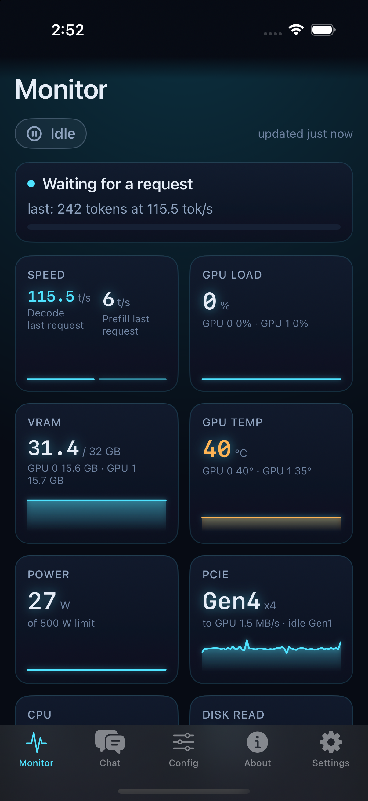
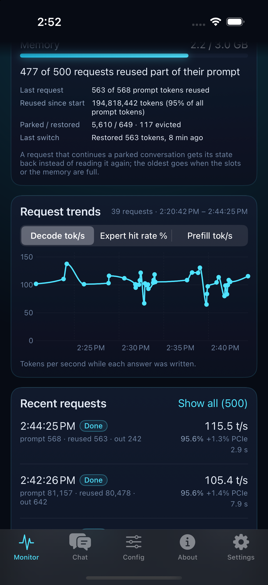
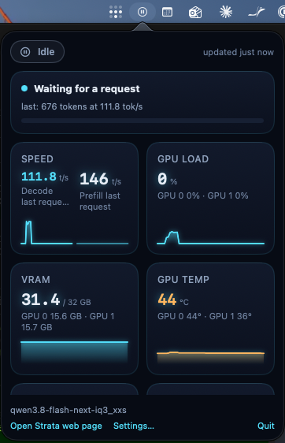
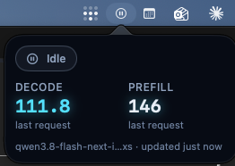
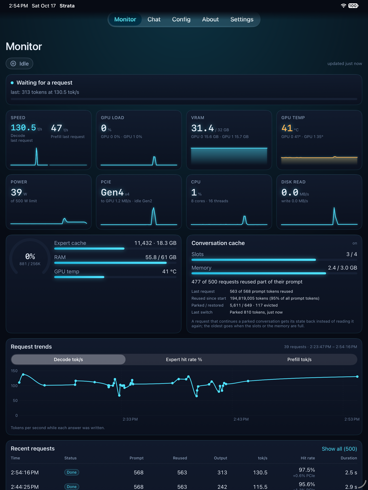
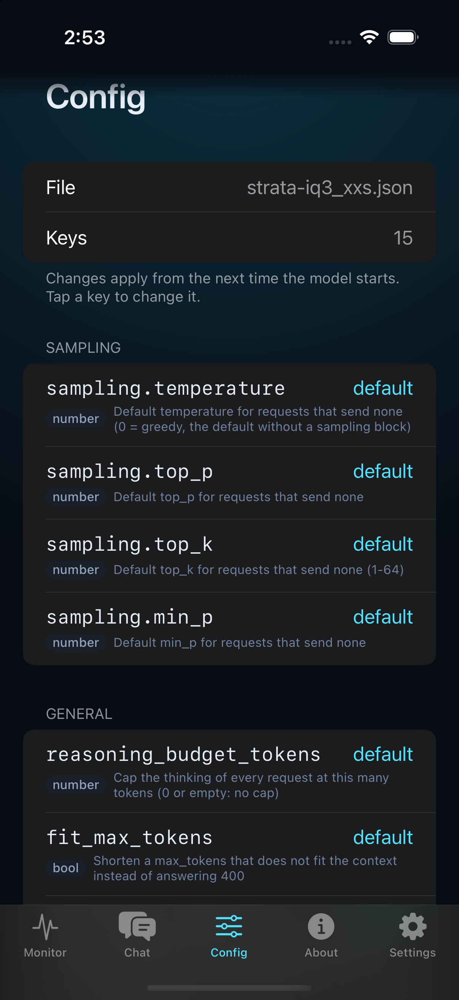
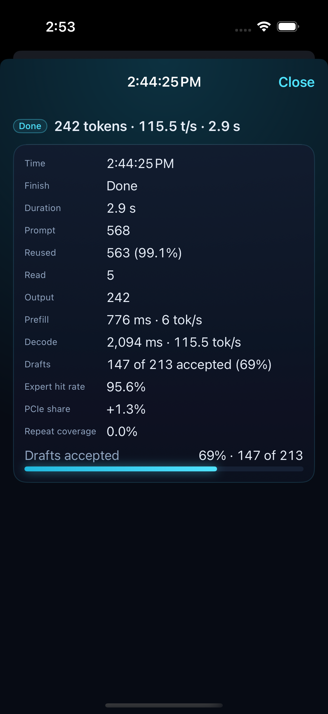
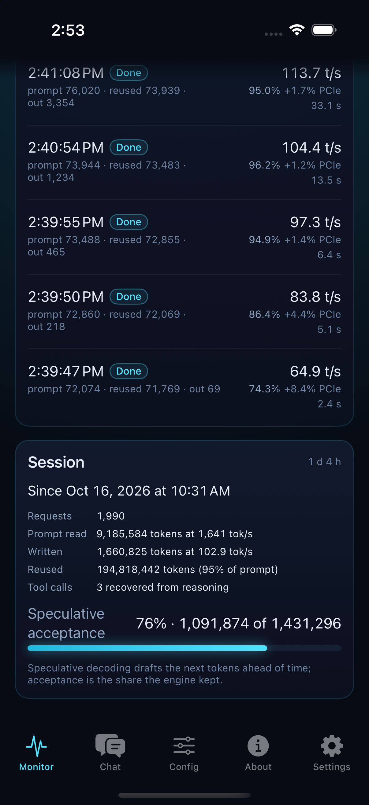
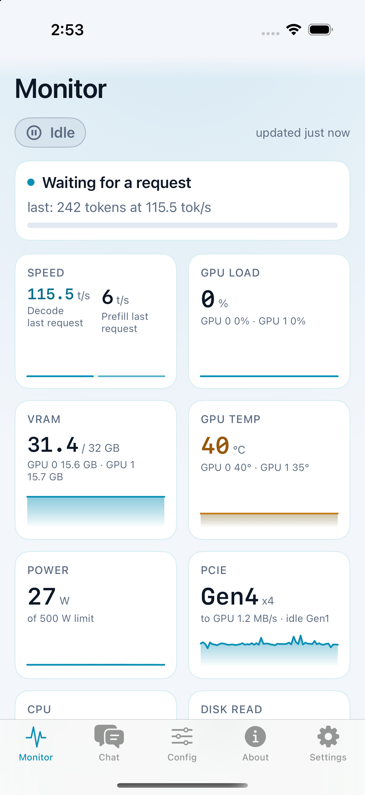

# Strata Monitor

Native apps for watching a [Strata](https://github.com/Niko1221/Strata) LLM server from your
other screens: an **iPhone / iPad app** and a **macOS menu bar app**, both built on one shared
Swift package. They read the same endpoints as Strata's own web Monitor, once a second, so what you
see is live: engine state, decode and prefill speed, GPU load, VRAM, temperature, power, PCIe,
the expert and conversation caches, every recent request, and the trends across them.

- **iOS / iPadOS** — Monitor, Chat, Config, About, Settings tabs.
- **macOS** — a menu bar item that shows the live speed, a hover card at a glance, a full popover
  on click.
- **Basalt too** — point it at a Basalt server and the apps notice (from `/health`) and adapt;
  see [Basalt servers](#basalt-servers).
- No third-party packages. Swift 6, SwiftUI, iOS 18+ / macOS 15+.

<p align="center">
  
  &nbsp;
  
  &nbsp;
  
</p>

<p align="center">
  
  &nbsp;&nbsp;
  
</p>

<p align="center">
  
</p>

## iPhone and iPad app

| Tab | What it shows |
|---|---|
| **Monitor** | Status pill, live state card, eight metric tiles with sparklines, context gauge, expert-cache / RAM / temperature bars, conversation cache, request trends, recent requests (tap for the full breakdown), session card with uptime, throughput and speculative-decoding acceptance. "Model unloaded" when `/health` says so. |
| **Chat** | Streaming client on `POST /v1/chat/completions`, mirroring the web page's defaults (thinking high, temperature 0.6, top_p 0.95, top_k 20). Thoughts fold under "Thought for N s", answers render as Markdown with code blocks, the meta line reads "201 tokens · 63.6 tok/s". Stop keeps what arrived. Last 20 conversations saved on the device. Text only. |
| **Config** | `GET /config` as a grouped list with Strata's own help text; tap a key to edit it with the right control for its kind. Saves with `POST /config`, shows the server's own error if it refuses. |
| **About** | Engine, hardware and API facts; the OpenAI and Anthropic base URLs copy to the pasteboard. |
| **Settings** | Up to two servers, edited one at a time: name, address, API key (Keychain), Save, Test connection, Remove. |

**Two servers** — once a second server has an address, a dropdown beside each tab's title picks
which one every tab shows. Each keeps its own name, address and Keychain entry.

**Trends** chart Decode tok/s, Expert hit rate % or Prefill tok/s across the last 40 requests;
tapping a point highlights its row in the list.

**iPad** gets its own layout: four tile columns, a real request table, resource and cache cards
side by side, content capped at 1200 pt. A narrow Split View falls back to the iPhone layout.

<p align="center">
  
  &nbsp;
  
  &nbsp;
  
  &nbsp;
  
</p>

## macOS menu bar app

`StrataMenuBar` lives in the menu bar only (no Dock icon), sandboxed with outgoing network access.

- **Label** — a state symbol plus the number that matters: `⚡ 104 t/s` while generating, `42%`
  while a prompt is read, just the icon when idle, `–` when the server does not answer. The icon
  sits on the right so the item never shifts when the text changes.
- **Hover** the icon — a read-only card with the state, **Decode** and **Prefill** in t/s (live
  while the engine works, the last request's values when idle), the model name and how fresh the
  numbers are.
- **Click** — the full popover: live state, the eight tiles, context gauge and bars, the last five
  requests, links to the Strata web page, Settings and Quit. **Right-click** — Settings and Quit.
- **Two servers** — each configured server gets its own menu bar item, hover card and popover,
  with the start of its name (or `1` / `2`) in front of the label so the two read apart. ⌘-drag
  to reorder; the order sticks.
- **Settings window** — per server: name, address, key (its own Keychain entry), Test connection,
  Remove; then Launch at login and the idle refresh rate (5 / 15 / 30 s; 1 s while a card is open).
- **Polling** — one `GET /metrics` (~13 KB) per tick, `/health` every tenth. When the server stops
  answering the delay doubles (5 → 10 → 20 → 40 → 60 s); after three misses at 60 s it stops
  altogether and the card says "Paused · click to retry". A click, a wake from sleep, an unlock
  or new settings start it again. Nothing is fetched while the Mac sleeps or the screen is locked.

## Basalt servers

Basalt answers the same `/health`, `/metrics` and `/v1` endpoints with the same API key, so it is
the same app. `/health` says `"service": "basalt"`, and the apps adapt:

- **Theme** — Basalt's ember orange from its own web page, in place of Strata's cyan, with a
  "Basalt server" badge over every screen title (and "Strata server" in blue on Strata). The
  engine each address answered last is remembered, so a Basalt server opens orange. On the Mac,
  each server's popover and hover card take that server's colours.
- **GPU tiles** — Basalt reports each card but not the totals; they are added up the way Strata
  does (mean load, summed VRAM and power, the hotter card, the slower PCIe link).
- **Sparklines** — Basalt keeps a history of the two speeds only; the apps sample the rest from
  each poll.
- **Slots** — Basalt runs two requests side by side. With more than one slot, `GET /slots` is read
  each tick: a Slots card shows each slot's state, speed, context and draft acceptance; the live
  card and Speed tile count the streams ("2 requests running · 76.0 tok/s total"); the context
  ring follows the fullest slot. A **Queue** card appears while requests wait for a free slot.
- **Experts** — where the last request's routed expert lookups came from: VRAM, the peer GPU,
  or the CPU.
- **Server log** — from the Monitor, a live tail of `GET /api/logs` with All / Warnings / Errors
  and search.
- **About** — engine and version, NVFP4 weights, slot count, every GPU by name, NVIDIA driver and
  CUDA. **Config** is hidden: Basalt has no run config.
- **Menu bar** — the popover gets the Queue, Slots and Experts cards; the hover card names both
  streams ("Generating · 2 streams", 40 + 40).

An address pasted from Basalt's web page (`http://host:8082/#stats`) works as it is.

## Build

Requires Xcode 16+ and [XcodeGen](https://github.com/yonaskolb/XcodeGen) (`brew install xcodegen`).
`project.yml` is the source of truth; the `.xcodeproj` is generated and not committed.

```sh
xcodegen generate

# iPhone / iPad app (+ all tests)
xcodebuild -scheme StrataMonitor \
  -destination 'platform=iOS Simulator,name=iPhone 16 Pro,OS=18.5' \
  -derivedDataPath build/DerivedData -collect-test-diagnostics never build test

# macOS menu bar app
xcodebuild -scheme StrataMenuBar -destination 'platform=macOS' -derivedDataPath build/DerivedData build
open build/DerivedData/Build/Products/Debug/StrataMenuBar.app
```

`-collect-test-diagnostics never` keeps `xcodebuild` from spending minutes collecting simulator
diagnostics after a run.

**Running on a device** needs your Apple team. Put it in a gitignored `project.local.yml` next to
`project.yml` and regenerate; or set Signing & Capabilities → Team in Xcode.

```yaml
settings:
  base:
    DEVELOPMENT_TEAM: YOURTEAMID
```

## Point it at your server

Open **Settings** (the app starts there until a key is saved), enter the server address
(`http://<host>:8081` by default for Strata) and the API key from Strata's config, tap **Test
connection**, then **Save**. The key goes into the Keychain and is sent only as a `Bearer` header
to that address. The Mac app has the same fields in its Settings window.

The iOS app polls while it is in the foreground and stops in the background; the Mac app polls
continuously at the rate you choose.

## How it is built

```
Packages/StrataCore/      shared: models, StrataClient, MetricsPoller, settings + Keychain,
                          Theme, formatters, view models, platform-neutral SwiftUI views, Chat core
StrataMonitor/            the iOS/iPadOS app: screens, tab bar, debug launch helpers
StrataMenuBar/            the macOS app: NSStatusItem controller, hover card, popover, settings
docs/reference-app.js     Strata's own web page JS (MIT), the source of truth for every derivation
tools/                    icon generator, mock server for states the live server won't show
```

- **Theme** — one `Theme` struct resolved per colour scheme; every colour comes from
  `Theme.swift` (no hex literals elsewhere). Dark is the showcase, light uses the same tokens, and
  the apps follow the system appearance. `ThemeTests` enforces WCAG AA contrast on every text pair.
- **Lenient decoding** — every field of `/metrics` is optional, so a newer or older Strata still
  renders what it sends.
- **Tests** — 374 across the package and the apps, driven by real server payloads in
  `Packages/StrataCore/Tests/StrataCoreTests/Fixtures`. `swift test --package-path Packages/StrataCore`
  runs the shared ones on the Mac.

<details>
<summary>Debug launch arguments (Debug builds only, for screenshots)</summary>

iOS simulator:

```sh
xcrun simctl launch booted com.jacou.StrataMonitor --tab=chat              # monitor | chat | config | about | settings
xcrun simctl launch booted com.jacou.StrataMonitor --scroll-to=cache       # resources | cache | trends | api | session | bottom
xcrun simctl launch booted com.jacou.StrataMonitor --open-request          # newest request's detail sheet
xcrun simctl launch booted com.jacou.StrataMonitor --select-trend          # taps the newest trend point
xcrun simctl launch booted com.jacou.StrataMonitor --open-config=vram_reserve_mib
xcrun simctl launch booted com.jacou.StrataMonitor --tab=chat "--ask=Say hello"   # asks once /health answered
xcrun simctl launch booted com.jacou.StrataMonitor --open-chat-settings
SIMCTL_CHILD_STRATA_API_KEY=<key> xcrun simctl launch booted com.jacou.StrataMonitor  # seeds the Keychain once
```

macOS:

```sh
open --env STRATA_SERVER=http://127.0.0.1:8098 --env STRATA_API_KEY=<key> StrataMenuBar.app  # seeds settings once
open StrataMenuBar.app --args --show-popover     # opens the popover 2 s after launch
open StrataMenuBar.app --args --show-hover       # opens the hover card and keeps it open
open --env STRATA_HOVER_LOG=1 StrataMenuBar.app  # os_log trail of the hover detection
```

`tools/mock-server.py` serves `/health` and `/metrics` from the fixtures, for states the live
server won't show (an unloaded model, a long generation):

```sh
python3 tools/mock-server.py false                       # 127.0.0.1:8099, loaded:false
python3 tools/mock-server.py true metrics_generating 8098
```

`simctl launch` on a running app only brings it to the front: terminate it first to change the
arguments. There is no `--rotate`; iPad landscape screenshots need the device turned by hand.
</details>

## Privacy and network

The apps talk only to the server address you enter, on your own network; nothing is sent anywhere
else. The API key is kept in the Keychain (never in UserDefaults, files or logs). Plain `http://`
is allowed because Strata serves plain HTTP on a LAN; prefer `https://` if you expose the server
beyond it.

## License

MIT, see [LICENSE](LICENSE). `docs/reference-app.js` is an unmodified copy of Strata's web page
(MIT, © the Strata authors). The fixtures are real responses from a Strata server.
