# Strata Monitor

A native iOS companion for a [Strata](https://github.com/Niko1221/Strata) LLM server. It polls
the same endpoints the server's own web Monitor uses and shows the live stats — engine state,
speed, VRAM, PCIe, the conversation cache, the recent-request list and the trends across the
requests the server kept — reads and edits the run config through `GET` / `POST /config`, and has
an About screen with the API endpoints you can copy into a client.

Everything that is not iOS — models, client, poller, settings, formatting, palette, layout and the
platform-neutral views — lives in a local package, `Packages/StrataCore`. Two apps build on it: the
iPhone/iPad app and a macOS menu bar app.

No third-party packages. iOS 18+, macOS 15+, Swift 6.

## Screens

**Monitor** — status pill, live state card, eight metric tiles with sparklines, the context
gauge, expert cache / RAM / GPU temperature bars, the conversation cache, the request trends
card, recent requests (tap a row for its detail sheet), and the session card: uptime, throughput
and speculative acceptance. When `/health` reports the model is not resident, the pill says
"Model unloaded" and the live card says the first request will load it.

**Request trends** — one series across the requests the server kept: **Decode tok/s** (line +
points), **Expert hit rate %** and **Prefill tok/s** (`(prompt − reused) / prompt_ms`, the web
page's prefill rate). Time runs left to right, the newest 40 requests at most, and the card needs
three points before it appears. It reads `metrics?requests=all` once on appear and every 30 s —
the 1 s poll stays on the ordinary payload. Tapping the chart picks the nearest request: the point
and its row light up, the row scrolls into view, and "Show all" turns on if the row was off screen.

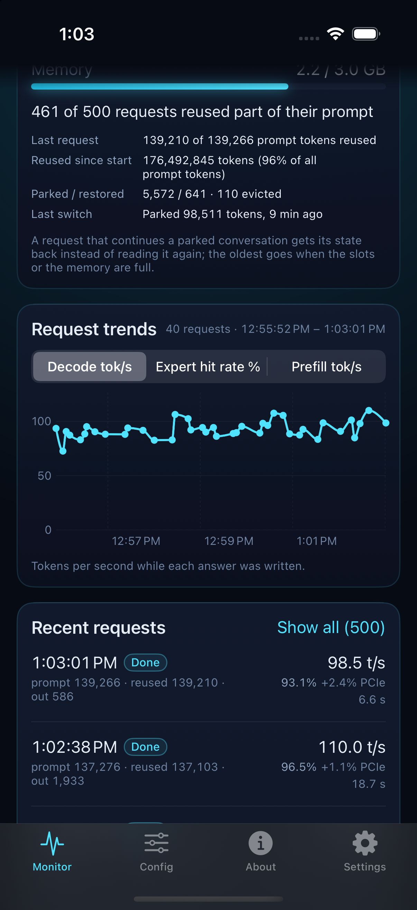
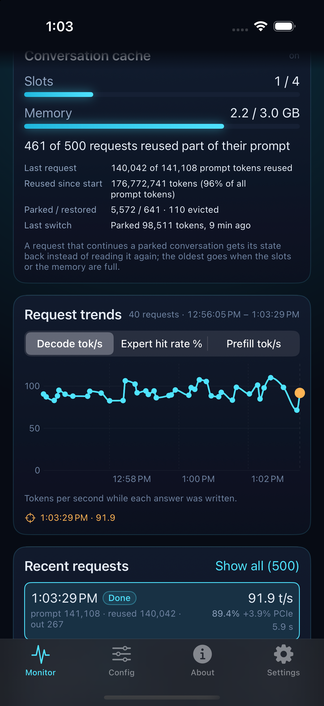
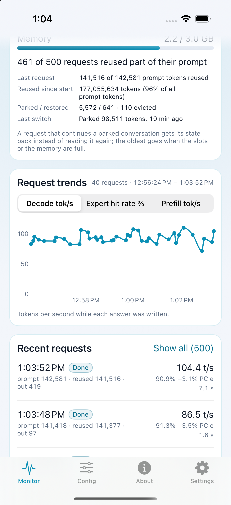
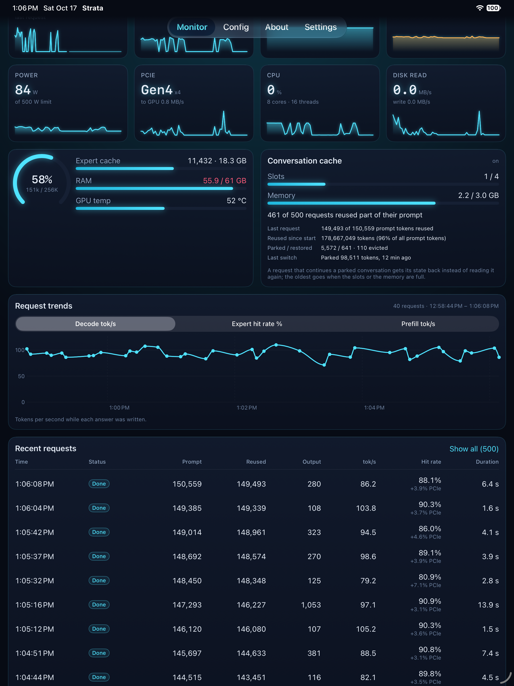

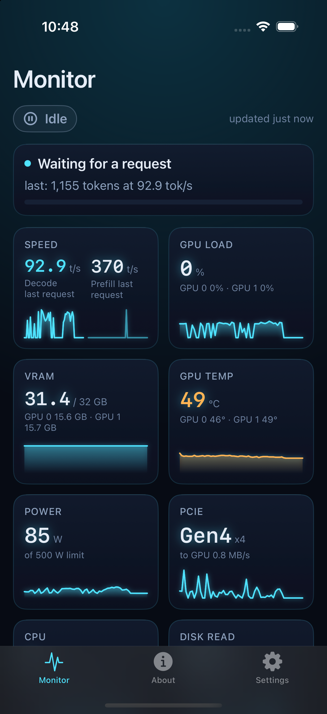
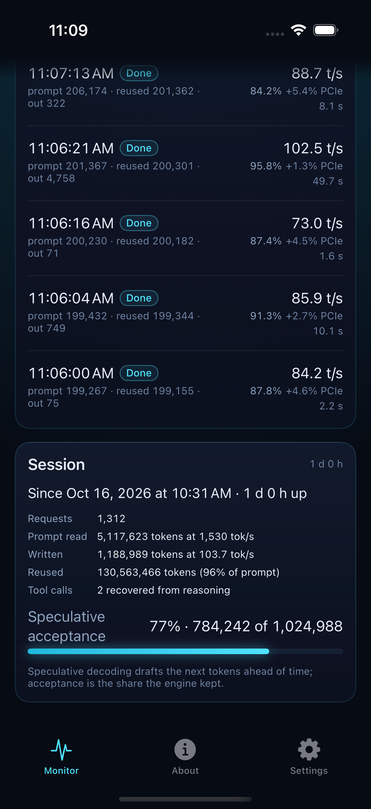
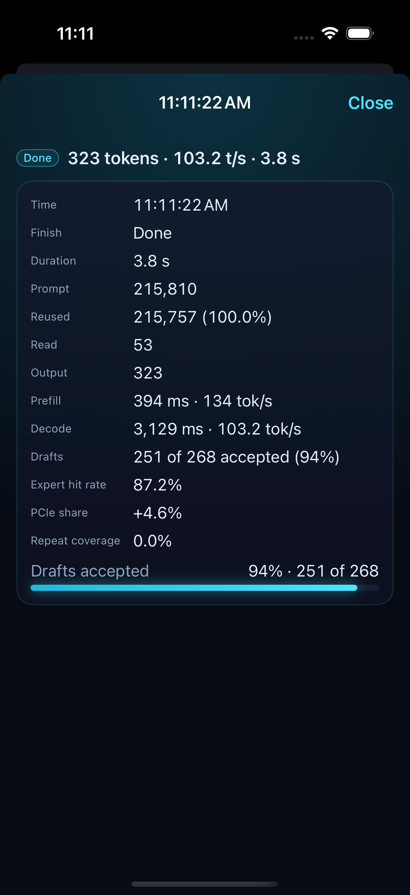
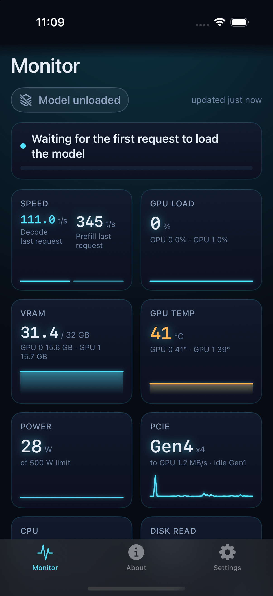
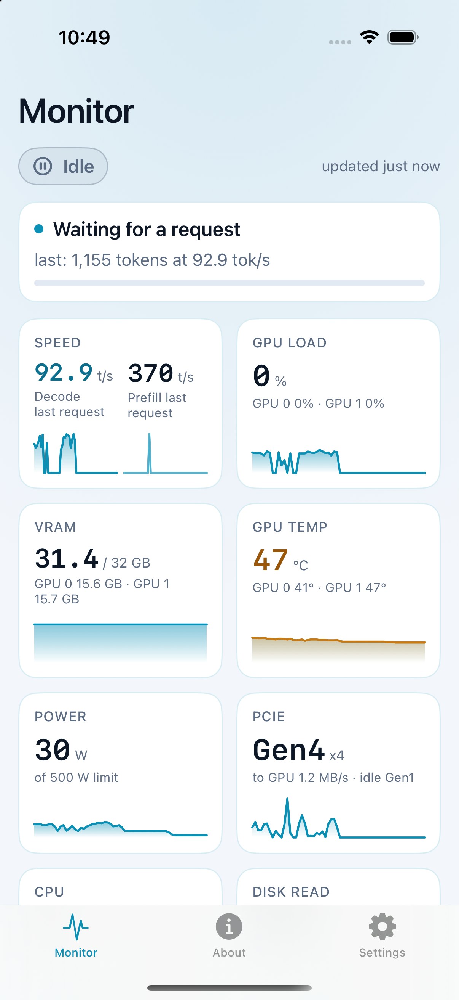

**Config** — `GET /config`: the run-config keys this server will edit, grouped by prefix
(`sampling.*` together), each row the key, its current value or "default", its kind and Strata's
own help text. Tap a row for the editor: a decimal field for a number, a toggle for a bool, a
picker built from the server's `choices` for an enum, a text field for names. Save posts
`{"set": {key: value}}` — only the keys that really changed, `null` for one you cleared — shows
the server's own words when it refuses, then re-reads the file. Changes apply from the next time
the model starts; the server leaves a `.bak` of the old file.

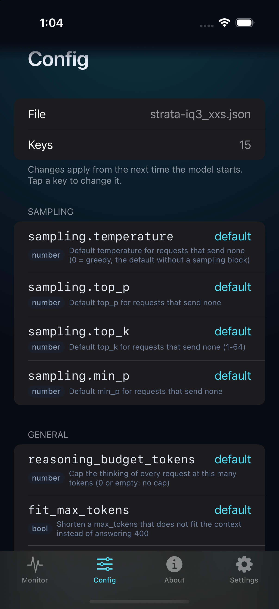
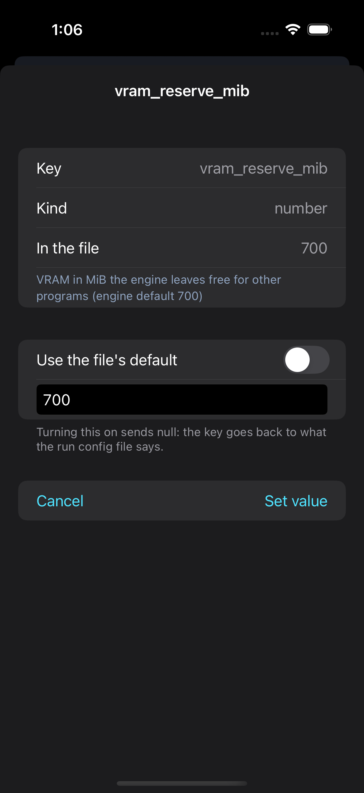
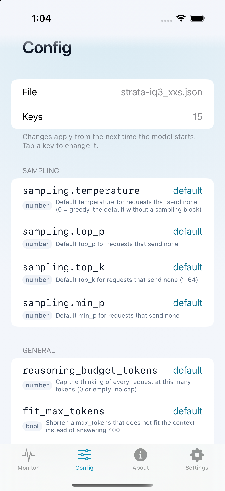

**Chat** — a streaming client on `POST /v1/chat/completions`, mirroring the web page's `send()`:
the same defaults (thinking high, temperature 0.6, top_p 0.95, top_k 20), the model's
`reasoning_content` folded under "Thinking… / Thought for N s", the answer as inline Markdown with
fenced code in a monospaced box, and the web page's meta line ("201 tokens · 63.6 tok/s"). Stop
cancels the request and keeps what arrived. Conversations (last 20) are saved in Application
Support; sampling settings, system prompt and seed live under the slider icon. Text only in v1.

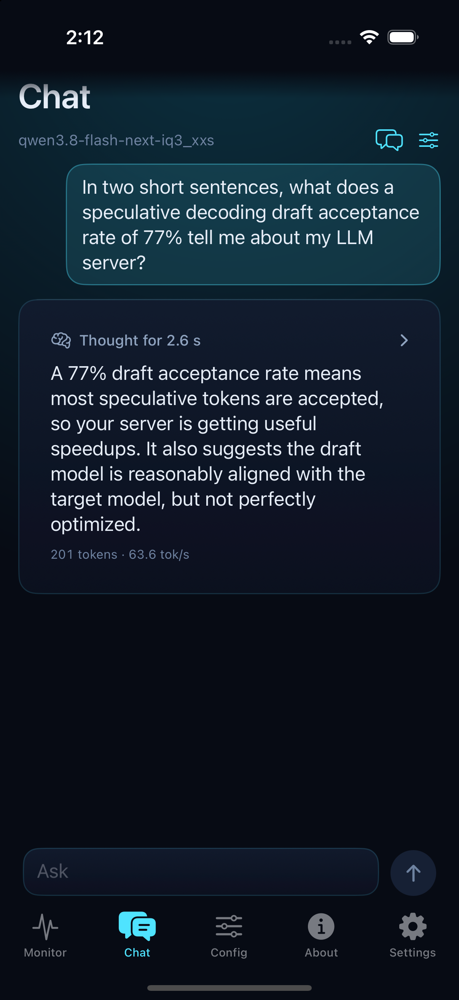
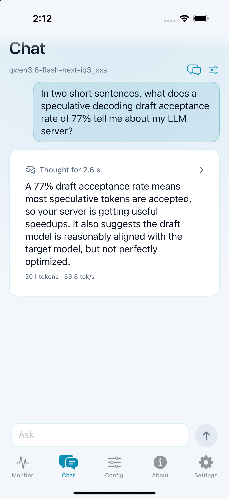

**About** — engine, hardware and API facts, each API row copyable to the pasteboard.

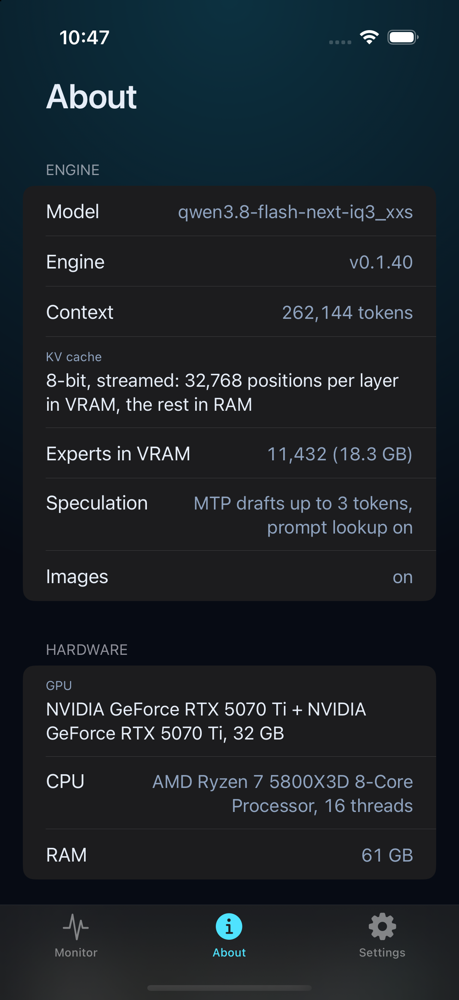

**Settings** — server address, API key, Save / Test connection, and what is currently saved.

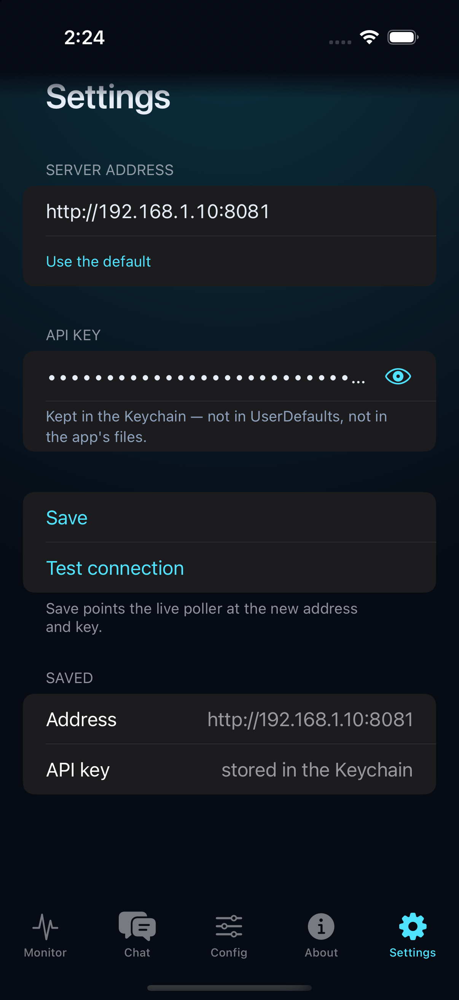

More shots live in `docs/screens/`.

## Look

The "Mission control" palette lives in `Packages/StrataCore/Sources/StrataCore/Theme/Theme.swift`:
one `Theme` resolved per colour scheme, injected with `@Environment(\.theme)`, and `strataTheme()`
on the root view. Every colour the app draws comes from that file — no hex literals anywhere else
— so dark (`#070B14` with a cyan accent and glow) and light (`#F3F6FB`) are the same tokens, not
two designs. The apps follow the system appearance; neither forces dark.

`ThemeTests` checks the tokens, the status → colour mapping, and that every text/background pair
clears WCAG AA (4.5:1). Two pairs needed a text variant of the token: the table's light accent
(3.7:1) and light warn (3.3:1) are fine as fills but too pale as text, so `accentText` and
`warnText` are darker in light mode. Light tertiary is `#5E6D82` rather than the table's
`#7B8AA0` for the same reason (3.2:1).

## Build

```
xcodegen generate
xcodebuild -scheme StrataMonitor \
  -destination 'platform=iOS Simulator,name=iPhone 16 Pro,OS=18.5' \
  -derivedDataPath build/DerivedData \
  -collect-test-diagnostics never \
  build test
```

`xcodegen generate` must run before building: `project.yml` is the source of truth and the
`.xcodeproj` is not committed. `-collect-test-diagnostics never` keeps `xcodebuild` from
spending minutes in `simctl diagnose` after a run.

To run on a physical device, open the generated project and set **Signing & Capabilities →
Team** (or `DEVELOPMENT_TEAM` in Xcode); the project itself leaves it empty. The simplest way is a gitignored `project.local.yml` next to `project.yml`:

```yaml
settings:
  base:
    DEVELOPMENT_TEAM: YOURTEAMID
```

`xcodegen generate` picks it up automatically.

## Point it at your server

Settings tab:

- **Server address** — defaults to `http://192.168.1.10:8081`. Any `http`/`https` host with an
  optional port is accepted; anything else shows an inline error and Save stays disabled.
- **API key** — written to the Keychain (`com.jacou.StrataMonitor` / `apiKey`), never to
  UserDefaults, never to source, never to a log. "Test connection" calls `/health` then
  `/metrics` and reports what failed.

The app reads `GET /health` and `GET /metrics` once a second while it is in the foreground and
stops when it is backgrounded.

## Tests

The shared core lives in `Packages/StrataCore` and carries its own test target — 248 tests for
the data layer, networking, settings, theme, layout and view models. Three real payloads
(`Packages/StrataCore/Tests/StrataCoreTests/Fixtures/metrics_idle.json`,
`metrics_generating.json`, `config.json` — the live server's own `GET /config`) drive the
formatting and derivation tests, so the strings match the web Monitor's. `StrataMonitorTests/`
keeps what is iOS-only (the tab bar).

```
# iOS: the app tests plus the package tests, compiled for iOS
xcodebuild -scheme StrataMonitor -destination 'platform=iOS Simulator,name=iPhone 16 Pro,OS=18.5' \
  -derivedDataPath build/DerivedData -collect-test-diagnostics never build test

# macOS: the same package tests on the Mac
swift test --package-path Packages/StrataCore
```

## macOS menu bar app

`StrataMenuBar` is a second app on the same core: an `NSStatusItem` with no Dock icon
(`LSUIElement`), App Sandbox with the network-client entitlement, and its own Keychain entry
(`com.jacou.StrataMenuBar` / `apiKey`) even though the settings code is shared. The item is AppKit
because a hover card needs a mouse-enter hook `MenuBarExtra` does not offer; every view inside it —
label, hover card, popover, Settings — is still SwiftUI, hosted through `NSHostingView`.

```
xcodegen generate
xcodebuild -scheme StrataMenuBar -destination 'platform=macOS' -derivedDataPath build/DerivedData build
open build/DerivedData/Build/Products/Debug/StrataMenuBar.app
```

- **Label** — an SF Symbol for the state plus the number that matters: `bolt.fill 104 t/s` while
  generating, `text.magnifyingglass 42%` while reading, nothing while idle,
  `exclamationmark.triangle –` when the server is not answering. Monospaced digits and a width that
  follows the label keep the item from jittering.
- **Hover card (260 pt, read-only)** — rest the pointer on the icon for 120 ms and a card appears:
  the state pill ("Generating · Thinking", so the speed under it is not printed twice), **Decode**
  and **Prefill** in t/s — live rates captioned "now" while the engine works, the last request's
  values captioned "last request" when it is idle, "–" when there is nothing to show — and one line
  with the model name and how fresh the numbers are. It closes 250 ms after the pointer leaves the
  icon or the card. An `NSTrackingArea` on `NSStatusBarButton` never delivers enter/exit (the status
  bar window swallows the pointer), so the hover is derived from mouse-move monitors plus a 0.2 s
  pointer check comparing `NSEvent.mouseLocation` with the item's rect in screen coordinates.
- **Click** toggles the full popover (360 × 520): pill and "updated Xs ago", the live state card,
  the eight tiles in two columns (20 pt values, 28 pt sparklines), the context ring with the
  expert-cache / RAM / temp bars, the last five requests, then the model name with **Open Strata web
  page**, **Settings…** and **Quit** (⌘Q). **Right-click** gives Settings… and Quit.
- **Settings window** — the same address + key fields and the same `ConnectionTester` as the iOS
  Settings tab, plus **Launch at login** through `SMAppService.mainApp` and the idle poll cadence.
- **Polling** — continuous, because a menu bar app has no scene phase: 1 s while the hover card or
  the popover is on screen, and **5 / 15 / 30 s** otherwise, picked by "Refresh when closed" in
  Settings (`MetricsPoller.setInterval`).

Debug builds read `STRATA_SERVER` and `STRATA_API_KEY` from the environment when nothing is saved
yet, so a local stand-in server can be pointed at without typing:

```
open --env STRATA_SERVER=http://127.0.0.1:8098 build/DerivedData/Build/Products/Debug/StrataMenuBar.app
```

`STRATA_HOVER_LOG=1` in the same way turns on the `os_log` trail of the hover detection
(`log stream --level debug --predicate 'subsystem == "com.jacou.StrataMenuBar"'`).

## iPad

`MonitorLayout` decides the arrangement from the horizontal size class, the available width and
the text size: 4 tile columns on a regular-width screen (2 on iPhone, 1 at accessibility text
sizes), a real request table (Time / Status / Prompt / Reused / Output / tok/s / Hit rate /
Duration), the resource and conversation-cache cards side by side, the trends card across the full
content width, content capped at 1200 pt and the About and Settings forms at 720 pt. A narrow
Split View reports a compact size class and gets the iPhone layout back.

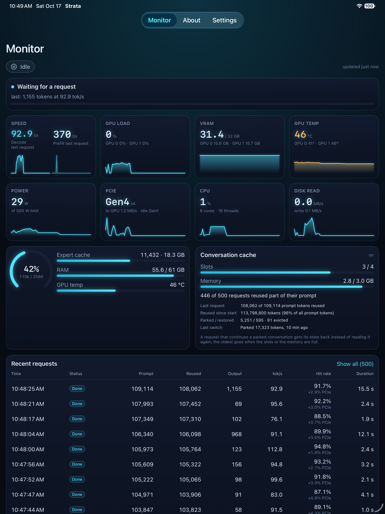
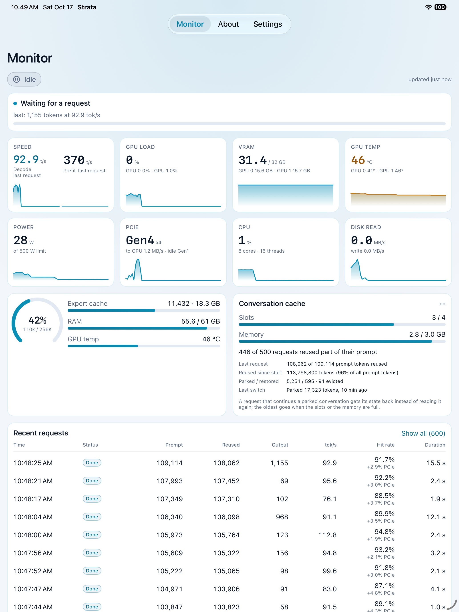


## App icon

`tools/make-icon.swift` draws `Assets.xcassets/AppIcon.appiconset/icon.png` (1024×1024) with
CoreGraphics: a radial teal glow centred behind the cyan pulse line, no text, full-bleed (iOS
applies its own mask).

```
swift tools/make-icon.swift                        # the icon
swift tools/make-icon.swift --preview docs/screens/t6-icon.png   # icon on a wallpaper, for review
```

## Debug launch arguments

Debug builds only, for taking screenshots without touching the simulator:

```
xcrun simctl launch booted com.jacou.StrataMonitor --tab=about
xcrun simctl launch booted com.jacou.StrataMonitor --scroll-to=cache   # resources / cache / trends / api / session / bottom
xcrun simctl launch booted com.jacou.StrataMonitor --open-request      # opens the newest request's sheet
xcrun simctl launch booted com.jacou.StrataMonitor --select-trend      # taps the newest point on the trends chart
xcrun simctl launch booted com.jacou.StrataMonitor --open-config       # a run-config key's editor sheet…
xcrun simctl launch booted com.jacou.StrataMonitor --open-config=vram_reserve_mib   # …this key's
SIMCTL_CHILD_STRATA_API_KEY=<your key> xcrun simctl launch booted com.jacou.StrataMonitor
```

`booted` means "the booted simulator" — with two of them up, name the device's id instead, or a
screenshot lands on the other one. `simctl launch` on an app that is already running only brings
it to the front, so terminate it first to change the arguments.

The environment variable only fills the Keychain when no key is stored yet. There is no
`--rotate`: an iPad refuses programmatic orientation changes (`UISceneErrorDomain` 101) and
simctl cannot turn the device, so a landscape screenshot needs the device rotated by hand.

States the live server won't show (an unloaded model) come from `tools/mock-server.py`, which
serves `/health` and `/metrics` from the test fixtures. Point the app at it while it is not running:

```
python3 tools/mock-server.py false &                 # 127.0.0.1:8099, loaded:false
python3 tools/mock-server.py true metrics_generating 8098   # fixture and port are arguments
xcrun simctl terminate booted com.jacou.StrataMonitor
xcrun simctl spawn booted defaults write com.jacou.StrataMonitor settings.baseURL http://127.0.0.1:8099
# screenshot, then put the address back
xcrun simctl spawn booted defaults write com.jacou.StrataMonitor settings.baseURL http://192.168.1.10:8081
```

Chat: `--tab=chat` opens the tab, `--ask="…"` asks that question once `/health` has answered
(simctl cannot type in the composer), `--open-chat-settings` opens the sampling sheet.

## Privacy and network

The apps talk only to the server address you enter, over your own network; nothing is sent
anywhere else. The API key is kept in the Keychain (never in UserDefaults, files or logs) and
is sent only as a `Bearer` header to that address. Plain `http://` is allowed because Strata
serves plain HTTP on a LAN; prefer `https://` if you expose the server beyond it.

## License

MIT — see [LICENSE](LICENSE). `docs/reference-app.js` is an unmodified copy of Strata's web page
(https://github.com/Niko1221/Strata, MIT) kept for reference; the metrics fixtures under
`Packages/StrataCore/Tests/.../Fixtures` are real responses from a Strata server.
